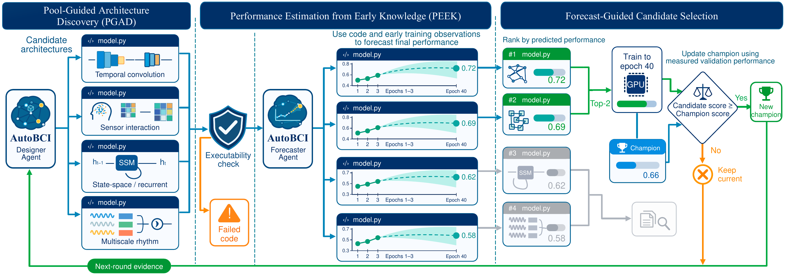

# AutoBCI: Forecast-Guided Agentic Neural Architecture Discovery for EEG-Based Brain–Computer Interfaces

[Paper](https://arxiv.org/abs/2609.35456) · [Winners](assets/v0.5_winners/)

> **v0.5 pre-release.** This repository is an early release of AutoBCI.

**AutoBCI** uses language-model agents to discover compact neural network architectures for EEG-based brain–computer interfaces. The agents propose model code, train and evaluate candidates, and use validation feedback to improve the next round of designs.

The repository includes the search loop, training code, experiment configurations, GPU coordinator, and six winning architecture definitions. **Datasets, preparation and preprocessing tools, and data-loading code will be released in a future version.**

## How AutoBCI works

1. **Propose:** the Designer Agent uses Heuristic Architecture Discovery (HAD) to generate PyTorch architectures and refine promising designs.
2. **Train and forecast:** candidates receive an initial training budget. The Forecaster Agent uses PEEK to predict their full-budget validation performance from source code and early learning curves.
3. **Continue and refine:** selected candidates continue training. Their validation results guide the next discovery round.
4. **Select and evaluate:** AutoBCI selects a winning architecture using validation scores. You then run held-out test evaluation explicitly.

The bundled presets evaluate each architecture independently on emotion recognition, motor imagery, and sleep staging. The result is one shared architecture design with separately trained weights for each task.



See [discovery trajectories and early forecasts](assets/discovery_and_forecasts.md) for additional figures and analysis.

## 1. Run the agent search loop

The commands below outline the agent search workflow. Running it end to end requires the dataset and loading setup planned for a future release. Run all commands from the repository root.

### Step 1: Prepare the environment

The recorded development environment is Ubuntu 26.04, Python 3.14.8, and PyTorch 2.14.1 with CUDA 13.0. The supplied training presets use an NVIDIA GPU with BF16 support and a compatible driver.

Install the Python dependencies in your environment:

```sh
python -m pip install -r requirements.txt
```

You also need the CLI selected by your experiment installed, available on `PATH`, and authenticated. The example below uses the Codex CLI and its existing login. Other supported CLIs and credential settings are listed under [Model access](#model-access).

### Step 2: Dataset setup (coming soon)

Dataset preparation, preprocessing, and loading instructions will accompany the future dataset release. The experiments cover emotion recognition, motor imagery, and sleep staging.

### Step 3: Choose and check an experiment

Start with [config/experiments/gpt-6-sol.yaml](config/experiments/gpt-6-sol.yaml), or choose another preset in [config/experiments/](config/experiments/).

Before launching, check:

- `search.model` and `search.harness`: the model and CLI that generate architectures.
- `peek.model` and `peek.harness`: the model and CLI that forecast performance. Set both model fields to models available to your account.
- `data.tasks`: the dataset catalogs to use.
- `search.name`: the name of your output directory. Use a new name for a new experiment.

The example preset runs six rounds with eight new candidates per round. Each candidate initially trains for 20 epochs on each task; PEEK promotes two candidates per round to continue to 40 epochs. See [Experiment settings](#experiment-settings) to change the budget.

### Step 4: Launch and monitor the search

Run all configured rounds sequentially on one GPU:

```sh
python -m autobci.run search --config config/experiments/gpt-6-sol.yaml --device cuda:0
```

From another terminal, check progress:

```sh
python -m autobci.run status --config config/experiments/gpt-6-sol.yaml
```

With the unmodified example preset, outputs are saved to `runs/gpt-6-sol/`. See [Search outputs](#search-outputs) for their contents. For parallel training or interrupted runs, see [GPU coordination and recovery](#gpu-coordination-and-recovery).

### Step 5: Evaluate the selected winner

After the search completes, evaluate the selected architecture and its task checkpoints on held-out test data:

```sh
python -m autobci.run final-test --config config/experiments/gpt-6-sol.yaml --device cuda:0
```

The combined results are written to `runs/gpt-6-sol/champion/test.json` with the default preset. Test scores are excluded from architecture generation and selection. See [Selection and final evaluation](#selection-and-final-evaluation) for the scoring protocol.

## 2. Inspect the authors’ winning rounds

Use this workflow to inspect the winning architectures from the authors’ search rounds. The manifest records the round and candidate ID for each winner. You can read all six implementations without setting up datasets, a GPU, or model-provider access.

Start in [assets/v0.5_winners/](assets/v0.5_winners/):

| Search model | Winning architecture | Saved experiment settings |
| --- | --- | --- |
| Claude Opus 5.5 | [model.py](assets/v0.5_winners/claude-opus-5-5/model.py) | [experiment.yaml](assets/v0.5_winners/claude-opus-5-5/experiment.yaml) |
| Claude Sonnet 5 | [model.py](assets/v0.5_winners/claude-sonnet-5/model.py) | [experiment.yaml](assets/v0.5_winners/claude-sonnet-5/experiment.yaml) |
| DeepSeek V4.1 Flash | [model.py](assets/v0.5_winners/deepseek-v4.1-flash/model.py) | [experiment.yaml](assets/v0.5_winners/deepseek-v4.1-flash/experiment.yaml) |
| Gemini 3.8 Flash | [model.py](assets/v0.5_winners/gemini-3.8-flash/model.py) | [experiment.yaml](assets/v0.5_winners/gemini-3.8-flash/experiment.yaml) |
| GPT-5.6 Sol | [model.py](assets/v0.5_winners/gpt-5.6-sol/model.py) | [experiment.yaml](assets/v0.5_winners/gpt-5.6-sol/experiment.yaml) |
| Qwen 3.8 Flash | [model.py](assets/v0.5_winners/qwen3.8-flash/model.py) | [experiment.yaml](assets/v0.5_winners/qwen3.8-flash/experiment.yaml) |

Each `model.py` defines a neural network and exposes `build_model(n_channels, n_samples, n_classes)`. The [manifest](assets/v0.5_winners/manifest.json) records candidate IDs, validation scores, source hashes, input shapes, and class labels. Its `model_file` paths are relative to `assets/v0.5_winners/`.

The saved `experiment.yaml` files document the original searches, which used full-budget independent task training. For a new search with PEEK, use the presets under `config/experiments/`. The manifest’s `experiment_config` paths are relative to the repository root; `config/...` paths inside each saved experiment file resolve from the repository root.

### Try a winning architecture

With PyTorch installed, run this Python example from the repository root. It loads the Claude Opus winner, creates randomly initialized weights, and checks the output shape on a synthetic emotion-recognition input. It runs on CPU and needs no datasets or provider access.

```python
import importlib.util
import json
from pathlib import Path

import torch

root = Path("assets/v0.5_winners")
records = json.loads((root / "manifest.json").read_text())["architectures"]
record = next(row for row in records if row["search_name"] == "claude-opus-5-5")
task = record["tasks"]["emotion"]

spec = importlib.util.spec_from_file_location("winner", root / record["model_file"])
module = importlib.util.module_from_spec(spec)
spec.loader.exec_module(module)

channels, samples = task["input_shape"]
model = module.build_model(channels, samples, task["n_classes"]).eval()
with torch.no_grad():
    logits = model(torch.randn(2, channels, samples))
print(logits.shape)  # torch.Size([2, 7])
```

The output is `torch.Size([2, 7])`: one vector of seven class logits for each of two inputs. To inspect another winner, change `search_name`; to use another task shape, change `emotion` to `mi` or `sleep`. These weights are randomly initialized; train the model before using it for predictions. The manifest’s selection scores describe validation results from the original searches.

## Reference

### Experiment settings

Choose an experiment YAML from [config/experiments/](config/experiments/), such as the [Codex preset](config/experiments/gpt-6-sol.yaml), and pass it to the commands below with `--config`. This is the main file to edit when choosing models, setting the search budget, or changing training settings.

Once the dataset setup is available, configure [Model access](#model-access) and choose a unique `search.name` for your results. The supplied presets provide the starting experiment settings.

| Setting in the experiment YAML | What it controls |
| --- | --- |
| `search.name` | Run directory name: results are saved to `<output.root>/<search.name>/` |
| `search.model`, `search.harness` | Model and CLI used by HAD to propose architectures |
| `peek.model`, `peek.harness` | Model and CLI used by PEEK to forecast performance; these can differ from HAD |
| `search.rounds` | Number of discovery rounds; HAD currently requires eight new architectures per round |
| `peek.early_epochs`, `peek.promote_count` | Initial training budget and number of architectures continued to the full budget |
| `training` | Full epoch budget, batch size, optimizer, learning rate, precision, and seed |
| `data.tasks` | Dataset catalogs for emotion recognition, motor imagery, and sleep staging |
| `output.root` | Output directory; relative paths resolve from the repository root |

The supplied presets run **six rounds with eight new architectures per round**. Each architecture trains independently on all three tasks for 20 epochs. PEEK uses these early curves to promote two architectures, which continue from their checkpoints to 40 epochs per task. Later discovery rounds generate three refinements for each of two selected parents, plus two new explorations. Training uses batch size 512 and seed 0; architectures must have fewer than one million trainable parameters.

When changing the budget, keep `peek.early_epochs` between 1 and `training.epochs - 1`, and `peek.promote_count` between `search.parent_count` and `search.new_candidates`, inclusive. Changing HAD's model does not change PEEK's model: edit both sections if you want them to use the same model. Use a new `search.name` when changing the experimental protocol.

Dataset directories are configured in [config/path.yaml](config/path.yaml). The emotion, MI, and sleep catalogs specify filenames relative to those directories, along with labels and splits. Relative directories in `config/path.yaml` resolve from that file’s directory. Provider endpoints and credential environment variable names are in [config/harnesses.yaml](config/harnesses.yaml). Parallel GPU scheduling settings are in [config/coordinator.yaml](config/coordinator.yaml). Dataset catalogs use `config/datasets/emotion.yaml`, `config/datasets/mi.yaml`, and `config/datasets/sleep.yaml`; harness settings use `config/harnesses.yaml`. These `config/...` paths resolve from the repository root, independently of the working directory. Other relative paths resolve from the experiment YAML’s directory; absolute paths are also supported.

### Model access

Configure credentials through the environment variables named in [harnesses.yaml](config/harnesses.yaml), or use the supported native CLI login. Model availability depends on the selected provider and account.

| Model family | Harness | Credential source |
| --- | --- | --- |
| OpenAI | `codex` | Existing Codex CLI login |
| Anthropic | `claude-code` | `ANTHROPIC_API_KEY` or native Claude Code login |
| DeepSeek | `claude-code` or `opencode` | `DEEPSEEK_API_KEY` |
| Qwen and GLM | `claude-code` or `opencode` | `QWEN_TOKEN_PLAN_API_KEY`, using the configured Qwen endpoint |
| Gemini | `gemini` | `GEMINI_API_KEY` or native Gemini CLI login |

For example, export the key for the provider you intend to use:

```sh
export ANTHROPIC_API_KEY="your-api-key"
```

An optional live harness check sends a small model request without loading EEG data or generating architectures. Use a new output directory for each attempt:

```sh
python -m autobci.harness --model gpt-6-sol --harness codex --output runs/harness_check_gpt6_01
```

### GPU coordination and recovery

The GPU coordinator requires `nvidia-smi`. For parallel training, generate a round and then launch the coordinator:

```sh
python -m autobci.run generate --config config/experiments/gpt-6-sol.yaml
CUDA_VISIBLE_DEVICES=0,1 python -m autobci.coordinator gpt-6-sol round_01
```

`generate` prepares the first unfinished round. The coordinator runs early training for every candidate/task pair, invokes PEEK once, and continues the promoted architectures on all tasks from their saved optimizer, scheduler, and RNG states. Once the round completes, call `generate` again and coordinate the next round, continuing through the configured search budget. The coordinator's first argument matches `search.name` in an active experiment config. It selects GPUs using live free memory and its running task counts, then summarizes the completed round automatically.

Check progress at any time:

```sh
python -m autobci.run status --config config/experiments/gpt-6-sol.yaml
```

Use `--search NAME` consistently across generation, training, status, and final evaluation to use a separate run directory. Start a new search name when changing the experimental protocol.

Completed rounds are validated and reused. An interrupted round requires an explicit restart through the coordinator:

```sh
python -m autobci.coordinator gpt-6-sol round_01 --resume-interrupted
```

This archives unfinished task files under `interrupted_training/` while retaining verified completed or failed outcomes. Interrupted early training restarts from epoch one; interrupted continuation restores the frozen early checkpoint used for PEEK's decision. Confirmed CUDA out-of-memory attempts are recorded and retried from the start of their training stage. The saved promotion is reused. Candidate code failures remain failed outcomes. Generated architecture source is checked against the original model response and is never repaired automatically.

### Selection and final evaluation

Validation balanced accuracy (bAcc) drives checkpoint and architecture selection. Within each task, AutoBCI averages per-dataset validation bAcc at each epoch and selects one common checkpoint epoch for that task. PEEK uses only architecture source and the configured early training and validation curves. Candidates must finish the observation budget on every task to be eligible for promotion; those not promoted are recorded as pruned. Promoted architectures that complete the full budget on every task enter the ranking by the unweighted mean of their best task validation scores.

Once all rounds finish, AutoBCI freezes the winning architecture and its independently selected task checkpoints. Use the `final-test` command in Step 5 to evaluate them.

Test scores do not enter generation, parent selection, or checkpoint selection. Evaluation records per-dataset bAcc, accuracy, Cohen's Kappa, macro F1, and weighted F1. Dataset-specific invalid output classes are masked before prediction.

### Search outputs

Outputs are written under `runs/<search.name>/` with the default `output.root`:

| Path | Contents |
| --- | --- |
| `round_XX/generation/` | Prompt, schema, original response, accepted response, and invocation metadata |
| `round_XX/candidates/` | Generated architecture source and candidate metadata |
| `round_XX/peek/` | Early evidence request, prompt, forecasts, saved promotion, and frozen early checkpoints for promoted architectures |
| `round_XX/training/<task>/` | Per-candidate configuration, verification, metrics, checkpoints, and failure records |
| `round_XX/summary.json` | Round outcomes, validation ranking, and compute accounting |
| `champion/<task>/` | Frozen architecture, selected checkpoint, selection metadata, and explicit test results |
| `champion/champion.json` | Shared winning architecture and task validation scores |
| `champion/test.json` | Combined final test results |

Training records include seeds, numerical settings, source hashes, and dataset split identities. Runtime progress is printed to the terminal.

## Code layout

The implementation is grouped into eight core modules, plus the package initializer:

| Module | Responsibility |
| --- | --- |
| [AutoBCI_HAD.py](autobci/AutoBCI_HAD.py) | Architecture generation, refinement, and parent selection |
| [AutoBCI_PEEK.py](autobci/AutoBCI_PEEK.py) | Early-curve forecasting and candidate promotion |
| [data.py](autobci/data.py) | Dataset catalogs, splits, preprocessing, and batch loading |
| [train.py](autobci/train.py) | Model verification, precision, training, checkpoints, and evaluation |
| [run.py](autobci/run.py) | Search rounds, independent task workflows, champion selection, and final testing |
| [coordinator.py](autobci/coordinator.py) | GPU scheduling, worker processes, and interruption recovery |
| [harness.py](autobci/harness.py) | Provider CLI calls, isolation, and response auditing |
| [common.py](autobci/common.py) | Configuration, artifact paths, JSON storage, and source provenance |

Runtime prompts remain in `autobci/prompt/`. The command-line entry points are
`autobci.run`, `autobci.train`, `autobci.coordinator`, and `autobci.harness`.

## Citation

If you use AutoBCI in your research, please cite our work using the BibTeX entry in [cite.bib](cite.bib).

```bibtex
@article{jiang2026autobci,
  title={AutoBCI: Forecast-Guided Agentic Neural Architecture Discovery for EEG-Based Brain--Computer Interfaces},
  author={Jiang, Muyun and Ding, Yi and Zhang, Wei and Chen, Jinbo and Liu, Chenyu and Yang, Zhenjie and Li, Yuxin and Chen, Jingyuan and Lu, Yuhao and Li, Yong and others},
  journal={arXiv preprint arXiv:2609.35456},
  year={2026}
}
```
