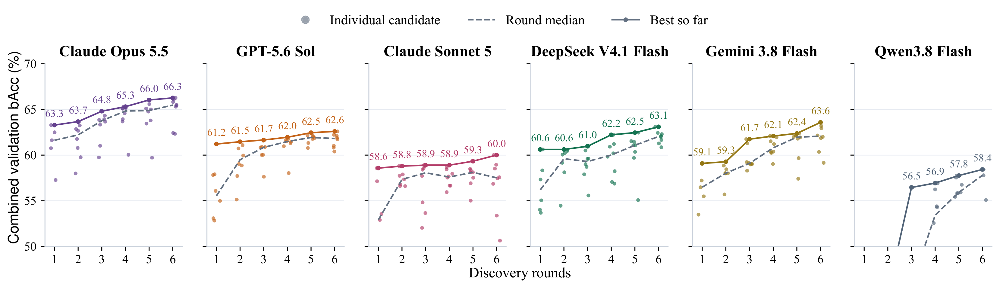
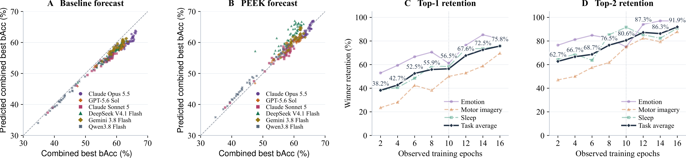

# Discovery trajectories and early forecasts

The figures below are reproduced from `AutoBCI.devel/Paper_v3_ICLR_Rebuttal`.

## Discovery trajectories

Dots represent candidates completed on all three tasks. Dashed lines show round medians, and solid lines track the best combined validation balanced accuracy (bAcc) so far. The vertical axis starts at 50%.

## Early forecasts and candidate retention

Panels A–B compare ten-epoch forecasts with actual combined validation bAcc for 269 architectures. Panels C–D show top-one and top-two task-winner retention across observation windows; dark curves average the three tasks equally. Dotted lines mark ten epochs.
